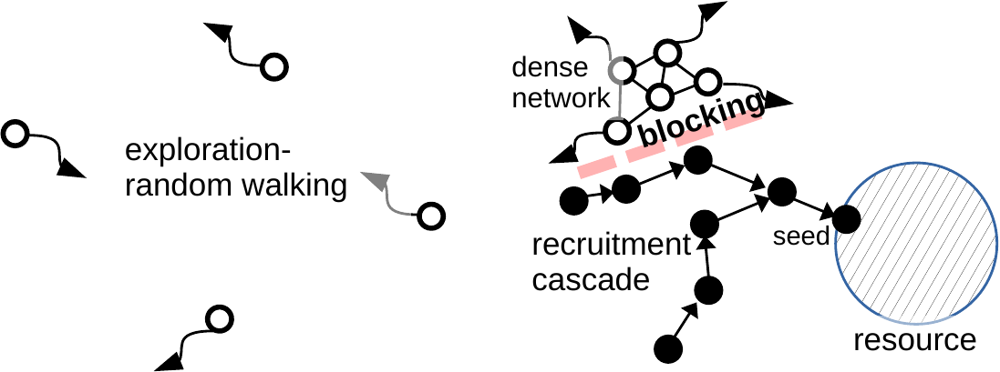
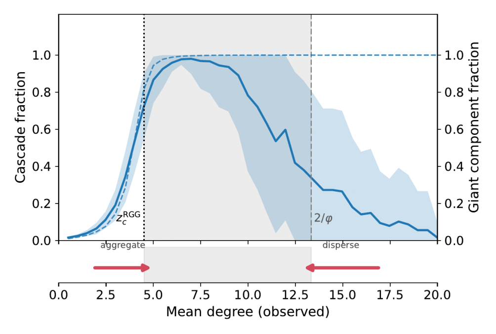
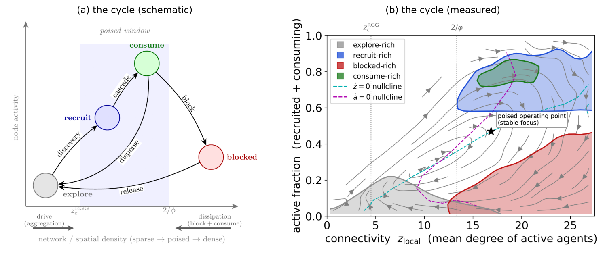

# Collective foraging from simple recruitment cascades
### percolating recruitment cascades coupled to a maximum-entropy field

Simulation code and the scripts that regenerate every figure and reported number in the paper of the
same name.

> **What's here.** The model, the figure generators, and the precomputed sweep data — it deliberately
> does **not** contain the paper source (`main.tex`) or PDFs. An accompanying **interactive demo** runs
> the whole story live in the browser: **<https://galenwilkerson.github.io/collective_foraging_demo.html>**.

## The idea

Recruitment is a **contagion**. A swarm forages with **one local rule and no central control**:
inactive agents wander by heavy-tailed **Lévy** flights, and when one finds a resource it seeds a
**linear-threshold cascade** — the Granovetter/Watts model built for how rumours and adoption spread on
networks — **embedded in space** on a proximity (random-geometric) graph. The twist is that being
recruited means *moving toward whoever recruited you*: **activation moves the node**, so the cascade
**rewires its own graph**. This is a spatially-embedded **adaptive network** — the swarm sets its own
connectivity as it runs.

Activation is **fraction-normalized**: a node activates once the fraction of its neighbours that are
already active clears its threshold, *aᵢ/kᵢ ≥ φ*. That single rule both **spreads** the cascade and
**stifles** it — as recruits crowd in, degree grows, the active *fraction* falls back below φ, and
recruitment shuts itself off (**blocking**, the mobile analogue of rumour-stifling). Agents then
disperse and re-explore. Nothing is tuned to make this happen.



Because a node activates on a *fraction*, the same rule draws two boundaries and opens a **cascade
window** between them:

- **percolation turns recruitment ON** near the random-geometric-graph threshold, mean degree
  *z_c^RGG ≈ 4.51* — below it the graph is fragmented and cascades stay local;
- **degree-blocking turns it OFF** at mean degree *2/φ* — above it high-degree nodes are non-vulnerable
  and cascades are suppressed.

The result is an **inverted-U**: cascade size is non-monotonic in connectivity, peaking in between. And
because the swarm's own recruitment sets *z*, the connectivity is **endogenous** — held, untuned, near
the marginal point. The restoring arrows below the axis show the swarm *self-tuning into the window*:
too sparse, cascades aggregate and raise *z*; too crowded, blocking disperses and lowers it.



**Self-organized criticality on a mobile lattice.** Poised just below marginal, the swarm runs the
Bak–Tang–Wiesenfeld sandpile's **drive–avalanche cycle** on a self-reshaping graph: near-critical local
branching (*σ_local ≈ 0.85*), **scale-free** recruited-cluster sizes, and a damped, **excitable**
relaxation whose mean flow in the (local-connectivity, active-fraction) plane spirals into a **stable
focus** — an empirical phase portrait built directly from the running model. This cycle is the paper's
hero figure: a schematic of the loop beside the measured phase portrait, in the same plane.



The two share an axis — the inverted-U above is this cycle's 1-D shadow, its restoring flow along
connectivity *z*.

**The elegant coincidences.** Untuned, this one rule reproduces — *together* — behaviours that foraging
biology documents *separately*: recruitment to discoveries, **marginal-value** patch-leaving,
**Lévy-then-local** search, and **reward-proportional** patch allocation. These are not accidents but one
least-committal principle: the resource field the swarm searches and the search it runs are both
**maximum-entropy** structures, and the swarm runs **two diffusions** — through space (exploration) and
through the network (recruitment). So it is **one principle wearing two disciplinary faces** —
collective order (active matter) and optimal foraging (ecology) — unified by **maximum entropy**
(where resources sit) plus **maximum caliber** (how to move).

The gains are deliberately **modest and conditional**: recruitment is movement-neutral and beats
solitary search (by ~15%) only when resources are sparse and clustered, with every communication bit
priced. The contribution is a **mechanism**, not a performance boast.

## Interactive demos (run in your browser)

The flagship demo is the **interactive in-browser swarm** linked at the top
(<https://galenwilkerson.github.io/collective_foraging_demo.html>) — one running swarm builds the whole
story live: **contagion → cascade window → SOC drive–avalanche cycle → the elegant coincidences**. The
demo below is a lighter, single-purpose companion.

- **[Why clumping is generic](https://galenwilkerson.github.io/collective-foraging-cascades/entropy.html)** —
  a maximum-entropy toy: drop M targets into K = M cells and watch that random placement is *clumpy*, not
  even. Run thousands of trials and the empty-cell-fraction distribution piles at e/M ≈ 0.37 while a
  perfectly even field never appears — the e⁻ᴹ rarity, live (the paper's entropy figure by Monte Carlo).

(Demo source lives in [`demos/`](demos/); the live links above are served from GitHub Pages.)

## Notation

The current paper uses **φ** for the linear-threshold activation threshold (older drafts wrote *θ*).
Also: resource coverage *ρ_s*, connectivity density *ρ_r*, Lévy exponent *α*, active fraction *A*,
branching ratio *σ*. This README follows the current notation (φ).

> **Code drift note.** Several simulation scripts and generators still use the variable name `theta`
> (and `.npz` keys like `theta`) for the threshold — e.g. `gen_cycle_statecolor.py`, `highd_opt_theta.npz`.
> These are the same quantity as φ. They are left unrenamed to avoid churn; only the prose is updated.

## Layout

```
Code/
  mobile_cascade.py         core model: mobile linear-threshold recruitment on a random geometric graph
  *_test.py, *_sweep.py …   experiment scripts that produce the sweep data in Code/sweeps/
  gen_*.py                  figure generators (see map below)
  sweeps/                   precomputed sweep outputs (.npz / .csv) the generators read
demos/                      browser demos (collective_foraging_demo.html, phase_portrait.html, entropy.html) served via Pages
theory_paper_v6/
  gen_entropy_fig.py        entropy figure — analytic, no data
  gen_article_figs.py       phase-diagram / local-clusters / FSS / scale-free figs — read Code/sweeps/
  figures/                  output dir for regenerated figures (PDFs not committed)
experiments/
  maxent_caliber/           max-caliber optimum (paper Fig. 12): run_maxent_caliber.py (16-core
                            parallel single-searcher sweep) + results.npz + replot_stable.py
```

Generators keep their original relative paths; run each from the directory it lives in.

> **Figure provenance.** The generators bundled here span the figure set used in the paper; some live in
> `theory_paper_v6/` (an earlier figure-generation snapshot) and `theory_paper_v14/gen/` (the criticality
> rework). Figure *numbers* below follow the paper and may shift between revisions.
> The v14 criticality suite is standardized on Lévy exploration (stable index α=1.5): the canonical
> per-avalanche branching data is `Code/sweeps/local_branching_levy.npz` (σ_local ≈ 0.83–0.99 across φ;
> the α=1.0 run is preserved as `local_branching_levy_a10.npz`). The old movement-mode "scale-free"
> figure was retired (a simulator-bug artifact, also step-scale-confounded); Fig 4 is now the
> recruitment-cascade avalanche-size distribution (`make_recruit_cluster.py`).

## Requirements

Python 3 with `numpy`, `matplotlib`, and `torch` (PyTorch; the model runs on CPU — no GPU required).

## Figure → generator map

| Fig | Generator | Data (in `Code/sweeps/`) / producer |
|----:|-----------|-------------------------------------|
| Cascade window (inverted-U) | `Code/gen_invertedu_fig.py`            | `inverted_u_full.csv` ← `inverted_u.py` |
| **Cascade window + self-tuning arrows (paper Fig. 2)** | `Code/gen_invertedu_selftune_fig.py` | same `inverted_u_full.csv` |
| Mechanism schematic         | `Code/gen_mechanism_fig.py`            | schematic (no data) — **paper now uses a TikZ source (`fig_mechanism_tikz.tex`), not in this repo** |
| Phase diagram (when it pays) | `theory_paper_v6/gen_article_figs.py` `fig_phase_diagram` | `resource_regimes.npz` ← `resource_regimes.py` |
| Target-space entropy        | `theory_paper_v6/gen_entropy_fig.py`   | analytic (exact combinatorics) |
| **Resource-field spectrum: one interaction sign sweeps regular→CSR→clustered (SI)** | `Code/gen_beta_spectrum_fig.py` | analytic (Metropolis Gibbs point process, no data) |
| **Sparsity amplifies the effective clustering β_eff ~ log(1/density) (SI)** | `Code/gen_beta_sparsity_fig.py` | analytic (Thomas cluster process, no data) |
| Local clusters (SOC)        | `theory_paper_v6/gen_article_figs.py` `fig_local_clusters` | `local_soc.npz`, `local_soc_levy.npz` ← `local_soc_test.py` |
| Threshold / blocking vs depletion | `Code/gen_threshold_figs.py`     | `blocking_test.py` |
| α-regime cost               | `Code/gen_alpha_regime_fig.py`         | `cost_per_target.py` |
| Homeostasis                 | `Code/gen_homeostasis_fig.py`          | self-contained (runs the model) |
| **Empirical phase portrait / drive–avalanche cycle (hero, paper Fig. 1b)** | `Code/gen_cycle_statecolor.py` | `sweeps/cycle_states.npz` ← `Code/gen_cycle_data.py` |
| **Cycle schematic (hero, paper Fig. 1a)** | `Code/gen_cycle_schematic.py` | schematic (no data) |
| Patch lifecycle             | `Code/gen_patch_lifecycle_fig.py`      | `patch_rw_th*.npz` ← `patch_lifecycle_test.py` |
| Reward-proportional allocation | `Code/gen_ifd_fig.py`               | `ifd_test.npz` ← `ifd_test.py` |
| FSS scaling                 | `theory_paper_v6/gen_article_figs.py` `fig_fss` | `fss_scaling.npz` ← `fss_scaling.py` |
| Scale-free field            | `theory_paper_v6/gen_article_figs.py` `fig_scale_free` | `scale_free_field.npz` ← `scale_free_field.py` |
| Susceptibility (supp.)      | `Code/gen_supp_expts_fig.py` (panel a) | `local_susceptibility_test.py` |
| Lévy field (supp.)          | `Code/gen_supp_expts_fig.py` (panel b) | `levy_field.npz` ← `levy_field_test.py` |
| **Max-caliber optimum — search exponent tracks field (paper Fig. 12)** | `experiments/maxent_caliber/replot_stable.py` | `experiments/maxent_caliber/results.npz` ← `run_maxent_caliber.py` |
| Q3 ablation                 | `Code/gen_q3_ablation_fig.py`          | self-contained (runs the model, coupled vs ablated) |

## Regenerating

Data-driven figures read precomputed sweeps, so the generators run directly, e.g.:

```
python theory_paper_v6/gen_entropy_fig.py
python theory_paper_v6/gen_article_figs.py
python Code/gen_homeostasis_fig.py
```

To recompute a sweep from scratch, run the corresponding producer script in `Code/` first.
