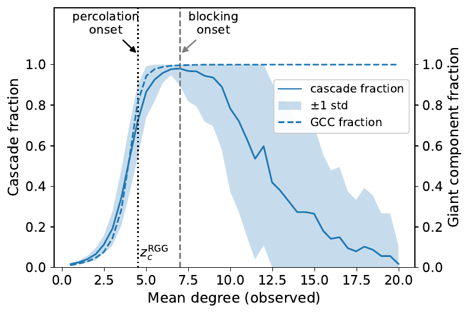

# Collective foraging from simple recruitment cascades — figure & simulation code

Simulation code and the scripts that regenerate every figure and reported number in the paper
*"Collective foraging from simple recruitment cascades: a maximum-entropy path to natural,
learner-free RL."*

> **Status: private.** This repository will be made public on publication of the paper.

## The idea

A swarm forages with **one local rule and no central control**. Agents wander by heavy-tailed
**Lévy flights**; when one encounters a resource it seeds a **linear-threshold recruitment cascade**
on the proximity graph — a neighbour is pulled in once a large enough *fraction* of *its* neighbours
is already active (the rule *a/k ≥ θ*). Crowding then drives that fraction back below threshold, so
recruitment **blocks itself** and agents disperse to explore again. Nothing is tuned to make this
happen.


Because a node activates on a *fraction*, cascade size is **non-monotonic** in connectivity: too
sparse and nothing spreads, too dense and blocking suppresses it — with an efficient **cascade
window** in between (below, the peak between the percolation and blocking boundaries). Out of this
single untuned rule fall the classic signatures of collective foraging — recruitment, marginal-value
patch-leaving, Lévy search, the ideal free distribution — and, coarse-grained, a **reinforcement-learning
policy with no learner**.



## Interactive demos (run in your browser)

- **[Swarm simulation](https://galenwilkerson.github.io/collective-foraging-cascades/swarm.html)** — a
  faithful browser port of `mobile_cascade.py`: agents explore by Lévy flights, recruit via a
  linear-threshold cascade, and self-limit through blocking. Sliders for every control, plus presets at
  the key regimes (below percolation → cascade window → blocking; Brownian vs. Lévy; balanced forager),
  with live plots of the explore/exploit cycle, cascade bursts, cluster-size criticality, and
  self-limitation.
- **[Why clumping is generic](https://galenwilkerson.github.io/collective-foraging-cascades/entropy.html)** —
  a maximum-entropy toy: drop M targets into K = M cells and watch that random placement is *clumpy*, not
  even. Run thousands of trials and the empty-cell-fraction distribution piles at e/M ≈ 0.37 while a
  perfectly even field never appears — the e⁻ᴹ rarity, live (the paper's entropy figure by Monte Carlo).

(Demo source lives in [`demos/`](demos/); the live links above are served from GitHub Pages.)

## Layout

```
Code/
  mobile_cascade.py         core model: mobile linear-threshold recruitment on a random geometric graph
  *_test.py, *_sweep.py …   experiment scripts that produce the sweep data in Code/sweeps/
  gen_*.py                  figure generators (see map below)
  sweeps/                   precomputed sweep outputs (.npz / .csv) the generators read
theory_paper_v6/
  gen_entropy_fig.py        Fig 3 (target-space entropy) — analytic, no data
  gen_article_figs.py       Figs 2b, 4, 11, 12 — read Code/sweeps/
  figures/                  reference PDFs of the figures as they appear in the paper
```

Generators keep their original relative paths; run each from the directory it lives in.
`theory_paper_v3/figures/` and `theory_paper_v5/figures/` are output stubs for a few generators.

## Requirements

Python 3 with `numpy`, `matplotlib`, and `torch` (PyTorch; the model runs on CPU — no GPU required).

## Figure → generator map

| Fig | Generator | Data (in `Code/sweeps/`) / producer |
|----:|-----------|-------------------------------------|
| 1  | `Code/gen_invertedu_fig.py`            | `inverted_u_full.csv` ← `inverted_u.py` |
| 2a | `Code/gen_mechanism_fig.py`            | schematic (no data) |
| 2b | `theory_paper_v6/gen_article_figs.py` `fig_phase_diagram` | `resource_regimes.npz` ← `resource_regimes.py` |
| 3  | `theory_paper_v6/gen_entropy_fig.py`   | analytic (exact combinatorics) |
| 4  | `theory_paper_v6/gen_article_figs.py` `fig_local_clusters` | `local_soc.npz`, `local_soc_levy.npz` ← `local_soc_test.py` |
| 5  | `Code/gen_threshold_figs.py`           | `blocking_test.py` |
| 6  | `Code/gen_alpha_regime_fig.py`         | `cost_per_target.py` |
| 7  | `Code/gen_homeostasis_fig.py`          | self-contained (runs the model) |
| 8  | `Code/gen_phase_fig.py`                | schematic (no data) |
| 9  | `Code/gen_patch_lifecycle_fig.py`      | `patch_rw_th*.npz` ← `patch_lifecycle_test.py` |
| 10 | `Code/gen_ifd_fig.py`                  | `ifd_test.npz` ← `ifd_test.py` |
| 11 | `theory_paper_v6/gen_article_figs.py` `fig_fss` | `fss_scaling.npz` ← `fss_scaling.py` |
| 12 | `theory_paper_v6/gen_article_figs.py` `fig_scale_free` | `scale_free_field.npz` ← `scale_free_field.py` |
| 13 | `Code/gen_supp_expts_fig.py` (panel a) | `local_susceptibility_test.py` |
| 14 | `Code/gen_supp_expts_fig.py` (panel b) | `levy_field.npz` ← `levy_field_test.py` |
| Q3 | `Code/gen_q3_ablation_fig.py`          | self-contained (runs the model, coupled vs ablated) |

## Regenerating

Data-driven figures read precomputed sweeps, so the generators run directly, e.g.:

```
python theory_paper_v6/gen_entropy_fig.py
python theory_paper_v6/gen_article_figs.py
python Code/gen_homeostasis_fig.py
```

To recompute a sweep from scratch, run the corresponding producer script in `Code/` first.
